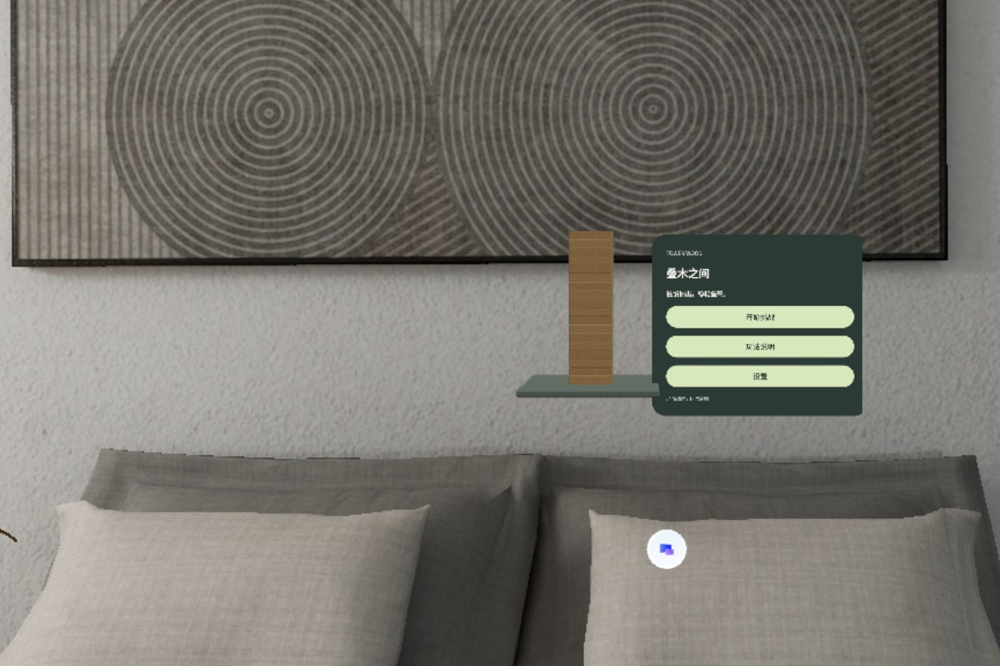
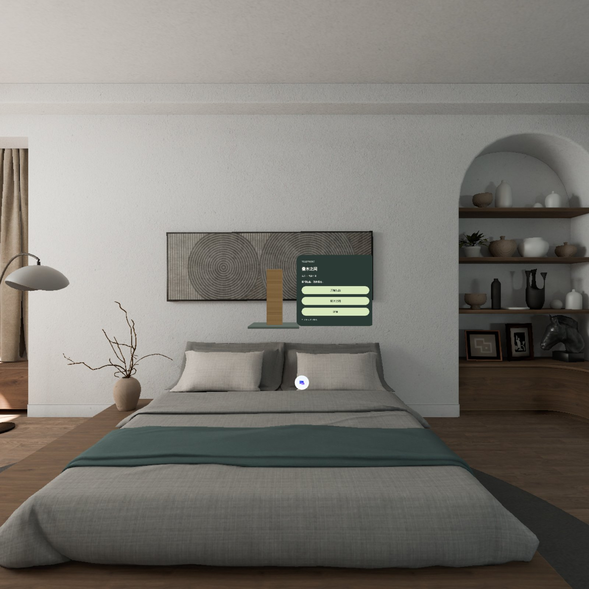
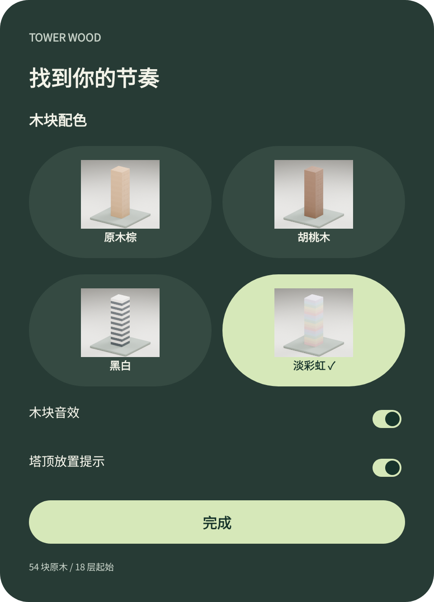
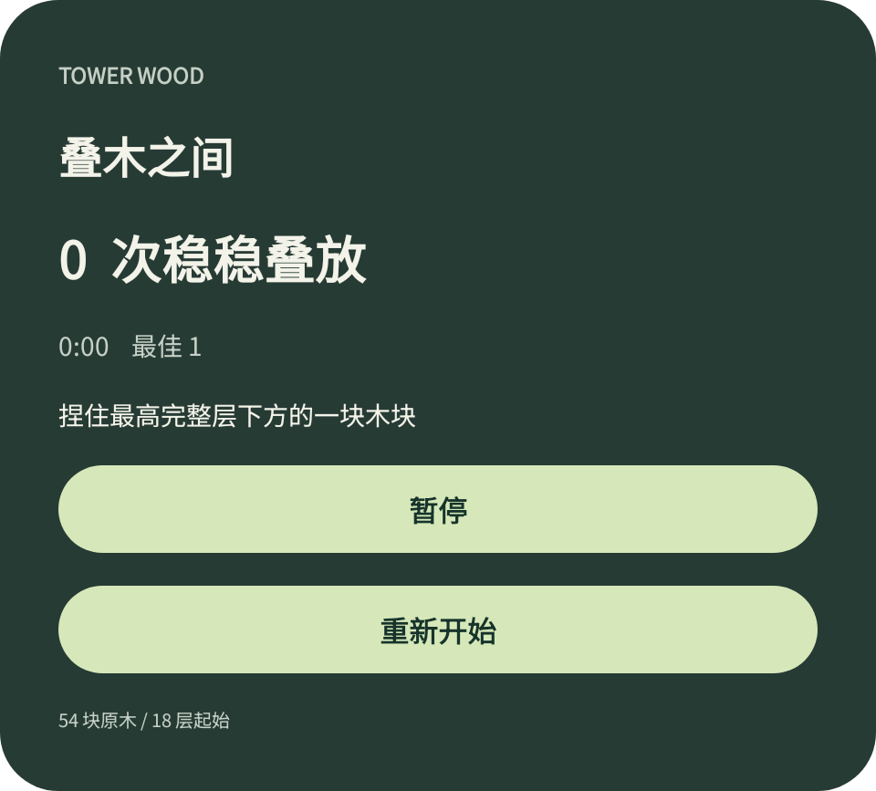
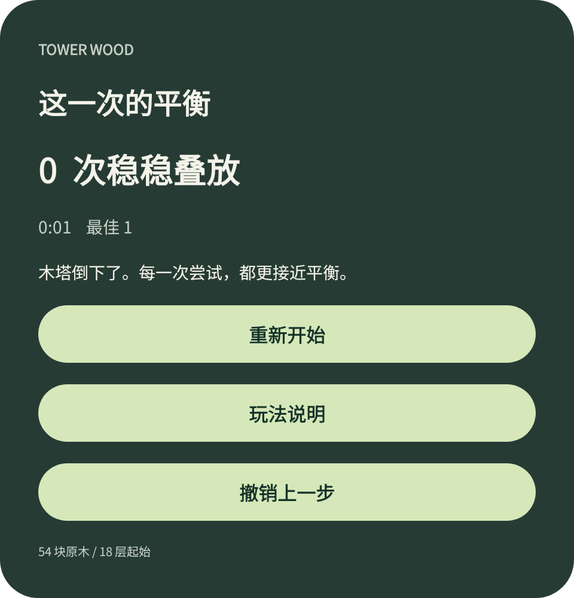

# SpatialJanga · 叠木之间 Tower Wood

**English** | [中文](README.zh-CN.md)

A single-player wooden block-stacking tower game for **PICO OS 6 Shared Space**, built natively in Kotlin on the **PICO Spatial SDK 6.1.9** with PICO Spatial UI. Pinch a block below the highest complete layer, slide it out along its long axis, lift it to the top and let go. The block scores once the tower has rested for one second. 54 blocks, 18 layers, one volumetric window, and the room comes from the system.



| Shared Space, wide view | Palette & settings | Playing | Round result |
| --- | --- | --- | --- |
|  |  |  |  |

Captured on PICO Emulator 6.1. The panel renders are Android View exports of the control panel and do not include the 3D tower.

## Downloads

- **APK**: [`releases/SpatialJanga-v1.0.0-debug.apk`](releases/SpatialJanga-v1.0.0-debug.apk) (debug build, arm64-v8a, `versionName 1.0`). The same file is attached to the [GitHub release](https://github.com/kejing-dev/SpatialJanga/releases). SHA-256 is recorded in [`docs/verification/verification.json`](docs/verification/verification.json).
- Install on PICO Emulator 6.1 or a PICO OS 6 device:

```bash
pico-cli app install SpatialJanga-v1.0.0-debug.apk --replace
pico-cli app launch com.kejing.towerwood
```

## Gameplay (v1.0)

- **Tower**: 54 blocks in 18 layers of 3, alternating 90° per layer. Original Blender block, 75 × 25 × 15 mm, 188 triangles, on a 0.24 × 0.24 m base.
- **Grab**: pinch one block below the highest complete layer. Before the block clears the tower it can only move along its long axis; afterwards it moves freely and follows wrist rotation. Speed-limited direct following, no spring servo.
- **Place**: translucent guides show the three slots on top of the tower (can be switched off). Release the block; it scores when it is on a legal top slot, supported, level within 12°, and the tower has been still for 1 second. One block per turn, one point per completed turn.
- **Cancel**: put the block back where it came from and let go; the turn is cancelled and nothing is scored.
- **Fail**: the target block dropping off the tower, or any block falling below the base or tipping past 45°, ends the round. Reaching 29 complete layers (the height cap of the volume) ends the round as a completed challenge.
- **Pause**: pausing, losing window focus, or a cancelled gesture freezes every block in place. Resume by grabbing the same block again.
- **Undo**: restores the full snapshot taken before the last grab (poses, score, time). Undo puts the round into practice mode, which never updates the personal best. Restarting clears the undo history.
- **Restart** with confirmation, available while playing, paused or on the result screen.
- **Palettes**: Natural, Walnut, Mono (charcoal / ivory) and Pastel (rose, peach, butter, mint, milk blue, lavender). Switching keeps block positions, score and undo history. Sound and placement guides can be toggled.
- **Saves**: personal best and the last completed round are stored locally. A recovered round is a practice round.
- UI text is Chinese, set in bundled Noto Sans SC.

## How it is built

- **Container**: one `Form.Volumetric` `DefaultWindowContainer`, 0.7 × 0.6 × 0.4 m, `WorldScale.Fixed`, `VolumeAlignment.Gravity`, uniform resize, no material background (configured in [`AndroidManifest.xml`](app/src/main/AndroidManifest.xml)). The system Shared Space provides the environment; the app draws no room.
- **Scene**: `SpatialView` + ECS. [`TowerScene.kt`](app/src/main/java/com/kejing/towerwood/scene/TowerScene.kt) owns the tower root (offset −0.13 m in X), 54 block entities with box colliders, `InteractableComponent` and `HoverEffectComponent`, three guide clones with `OpacityControllerComponent`, and a `PhysicsWorldComponent` stepped at 120 Hz with 32 / 8 solver iterations. The control panel is an `AttachmentPanel` placed at (0.17, 0.02, 0.02) m inside the same volume.
- **Physics model**: turn-based sleeping. Resting blocks keep their colliders but carry no dynamic rigid body. On grab, the blocks above the active floor get dynamic bodies; the held block follows a speed-limited handle. On release the held block becomes dynamic; after scoring the whole tower is static again. This is not a full-tower continuous simulation, and there is no general swept-collision constraint for the held block yet.
- **Input**: `detectSpatialDragGesture` in [`GameScreen.kt`](app/src/main/java/com/kejing/towerwood/ui/game/GameScreen.kt) maps drag start / move / end / cancel to grab, drag, release and pause. Drag deltas are converted from dp to meters with `LocalPhysicalLengthConverter`; the input device rotation drives block rotation relative to the wrist pose at grab time.
- **UI**: PICO Spatial UI only (`PicoTheme`, `Button`, `Switch`, `Text`); no Material. [`TowerTheme.kt`](app/src/main/java/com/kejing/towerwood/ui/theme/TowerTheme.kt) applies the Figma dark-green palette and Noto Sans SC to the whole typography set.
- **State**: [`GameViewModel.kt`](app/src/main/java/com/kejing/towerwood/ui/game/GameViewModel.kt) drives the phases `LOADING · HOME · SETTINGS · PLAYING · HOLDING · SETTLING · PAUSED · TRACKING_LOST · HELP · RESTART · RESULT · ERROR`. Rules live in [`StackRulesUseCase.kt`](app/src/main/java/com/kejing/towerwood/domain/usecase/StackRulesUseCase.kt); persistence is `SharedPreferences` behind [`GameRepository.kt`](app/src/main/java/com/kejing/towerwood/data/repository/GameRepository.kt).
- **Snapshots**: every grab pushes `score|seconds|highest,topCount|54 poses` onto the undo stack; the same string is the saved round. Restore validates the whole string before touching the live scene.
- **Sound**: `SoundPool` plays `wood_tap.wav` on each score.

## Build and run

Requirements: JDK 21, Android SDK 35, Gradle wrapper 8.13 (AGP 8.13.2, Kotlin 2.1.20), access to the PICO Maven repository configured in [`settings.gradle.kts`](settings.gradle.kts), and a `local.properties` with `sdk.dir` and `spatial.tools.dir` (PICO SDK tools directory).

```bash
export JAVA_HOME=~/.pico/primer-cli/jdk/jdk-21.0.12.1+1/Contents/Home
./gradlew testDebugUnitTest assembleDebug
pico-cli emulator start            # or connect a PICO OS 6 device
pico-cli app install app/build/outputs/apk/debug/app-debug.apk --device emulator-5554 --replace
pico-cli app launch com.kejing.towerwood --device emulator-5554
pico-cli capture screenshot --out shot.png
```

Emulator integration tests (target the PICO emulator explicitly so phone emulators are skipped):

```bash
ANDROID_SERIAL=emulator-5554 ./gradlew connectedDebugAndroidTest
```

## Verification status

| Area | Result |
| --- | --- |
| Build, install, launch | Passed on PICO Emulator 6.1 (`emulator-5554`) |
| Unit tests | 20 passed: 13 `GameViewModelTest`, 6 `StackRulesUseCaseTest`, 1 scaffold sample |
| Emulator integration tests | 3 passed: a full round through scene handlers (load 54 blocks → 5 s idle → pause freezes poses → extract block 49 → pause / resume → lift to top → release → stable, score 1), the theme picker switching four palettes with 54 visual children and unchanged transforms, and the package test |
| Architecture and Spatial UI style checks | Passed; one suggestion left (`collectAsStateWithLifecycle`) |
| Shared Space capture | `pico-cli capture screenshot` shows tower, base and panel in the system room |
| Real hand tracking, UI ray hits | **Not verified**: the instrumentation calls scene handlers directly |
| PRD acceptance (60 s idle without collapse, 10 consecutive rounds) | **Not run** |
| Physical PICO device | **Not tested** |

Full report: [`docs/verification/`](docs/verification/) (`verification.json`, raw Shared Space captures, panel renders). Panel renders `01`–`03` predate the panel background contrast fix; `dropped.png`, `reset.png` and `theme-picker.png` are current.

## Known gaps

- Pinch hit testing, wrist-rotation feel, tracking loss and regain, tower response over many rounds, and window moving / clipping in Shared Space still need a real emulator window or device.
- The text tutorial has not been replaced by the step-by-step spatial demo drawn in Figma.
- Extreme movement or rotation of the held block can still misbehave without swept collision.

## Repository layout

- `app/` Android module: `Main.kt` entry DSL · `platform/` SDK entry points · `scene/` 3D scene and physics · `ui/game/` Spatial UI, view model, palettes · `ui/theme/` PicoTheme · `domain/` rules · `data/` persistence · `assets/` runtime GLBs · `res/font/` Noto Sans SC.
- `art/` Blender sources (`tower_wood.blend`, `themes/tower_palettes.blend`), 54-block tower and single-block GLBs, base, original wood textures, palette GLBs and previews, generator scripts (`generate_tower.py`, `themes/generate_themes.py`), manifests and font licence.
- `docs/` [`PRD.zh-CN.md`](docs/PRD.zh-CN.md) product requirements v0.1 with the implementation addendum · [`DELIVERY-NOTES.zh-CN.md`](docs/DELIVERY-NOTES.zh-CN.md) original delivery notes · `verification/` emulator report · `screenshots/` README images.
- `releases/` shipped APK.
- `AGENTS.md`, `CLAUDE.md`, `PICO-SPATIAL-AGENTIC-TOOLS.AGENTS.md` agent context: project notes for coding agents and the pico-cli plugin guidance the project was scaffolded with.

## Design references

- Figma: <https://www.figma.com/design/JfpAG3K8uxFkc7H2p59hFf/> (28 state frames and a UX branch map; an editable design file, not a wired prototype).
- PRD v0.1, 2026-09-16, with the 2026-09-17 implementation addendum: [`docs/PRD.zh-CN.md`](docs/PRD.zh-CN.md).

## Assets and licences

- Wood block models, textures and palettes are original, generated with Blender by the scripts in `art/`.
- Noto Sans SC is bundled under the SIL Open Font License 1.1 ([`app/src/main/assets/NotoSans-OFL.txt`](app/src/main/assets/NotoSans-OFL.txt)).
- No licence has been chosen for the source code yet.
