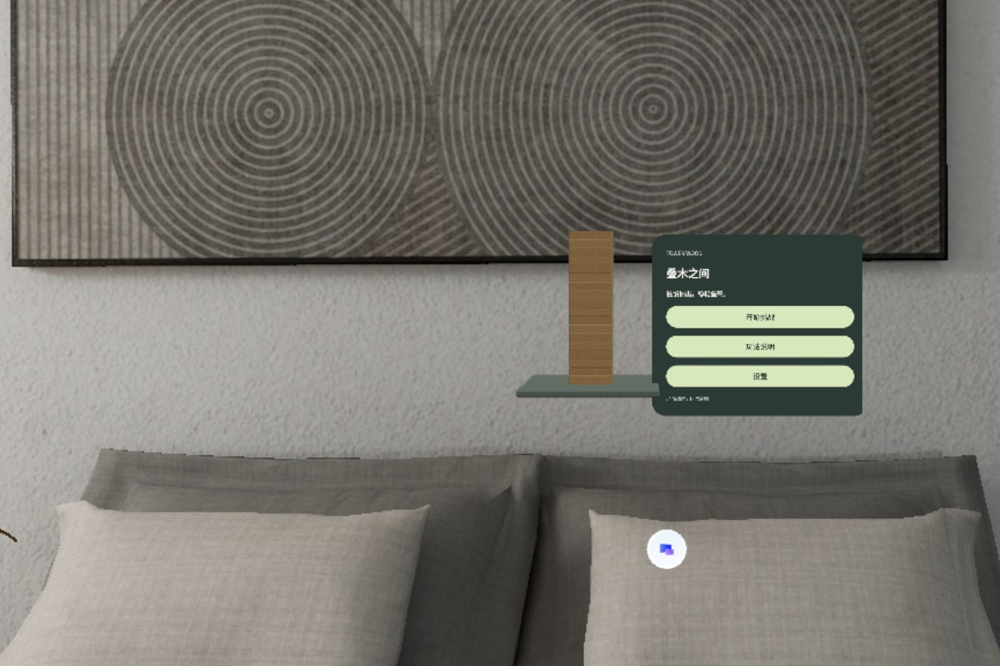
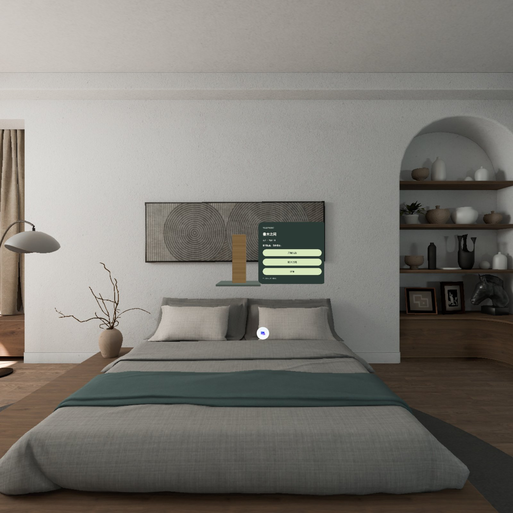
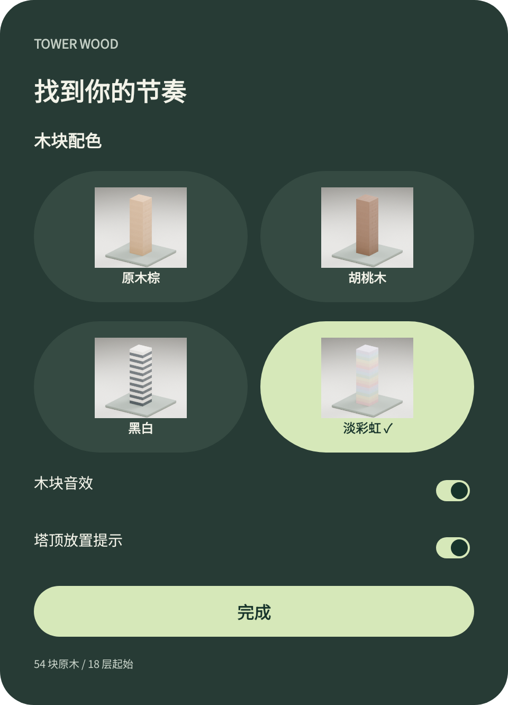
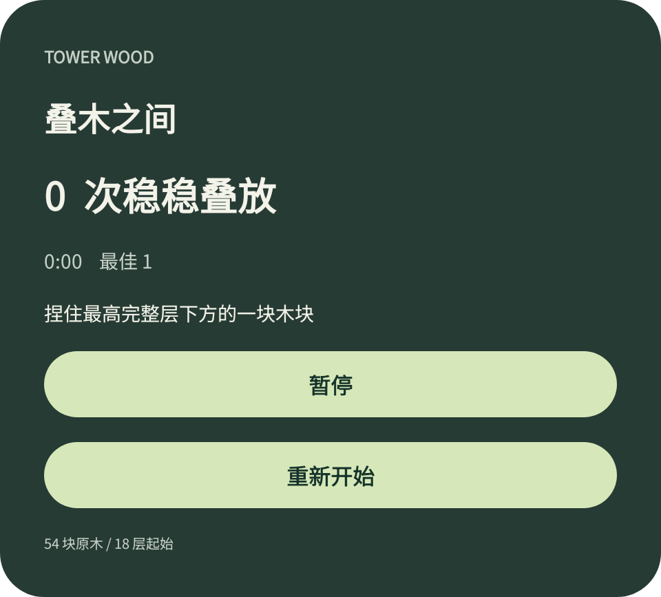
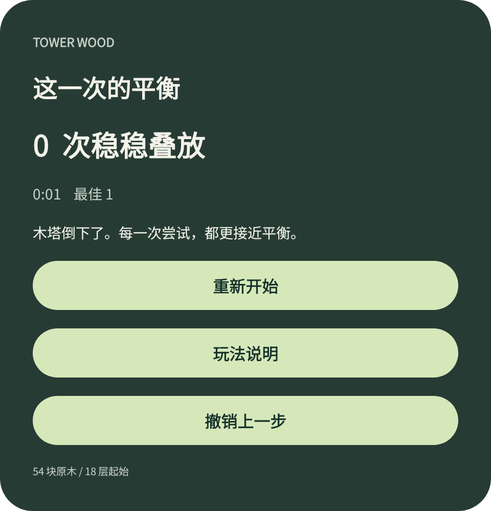

# SpatialJanga · 叠木之间 Tower Wood

[English](README.md) | **中文**

运行于 **PICO OS 6 共享空间（Shared Space）** 的单人叠木塔游戏，使用 Kotlin 与 **PICO Spatial SDK 6.1.9** 原生开发，界面基于 PICO Spatial UI。捏住最高完整层下方的一块木块，沿长轴缓慢抽出，抬到塔顶后松手；木塔静止一秒即计一分。54 块木块、18 层、一个体积窗口，房间由系统共享空间提供。



| 共享空间全景 | 配色与设置 | 游戏中 | 回合结算 |
| --- | --- | --- | --- |
|  |  |  |  |

以上截图来自 PICO Emulator 6.1。面板图是控制面板的 Android View 渲染导出，不包含 3D 木塔。

## 下载

- **APK**：[`releases/SpatialJanga-v1.0.0-debug.apk`](releases/SpatialJanga-v1.0.0-debug.apk)（调试版，arm64-v8a，`versionName 1.0`）。同一文件也挂在 [GitHub Release](https://github.com/kejing-dev/SpatialJanga/releases) 上。SHA-256 记录在 [`docs/verification/verification.json`](docs/verification/verification.json)。
- 安装到 PICO Emulator 6.1 或 PICO OS 6 设备：

```bash
pico-cli app install SpatialJanga-v1.0.0-debug.apk --replace
pico-cli app launch com.kejing.towerwood
```

## 玩法（v1.0）

- **木塔**：54 块、18 层、每层 3 块，相邻层方向相差 90°。Blender 原创木块 75 × 25 × 15 mm，每块 188 个三角面，底座 0.24 × 0.24 m。
- **抓取**：捏住最高完整层下方的一块。木块离塔前只能沿长轴移动，离塔后可自由移动并跟随手腕旋转。限速直接跟随，不使用弹簧伺服。
- **放置**：塔顶显示三个半透明放置提示（可关闭）。松手后，木块位于合法顶层位置、有支撑、倾斜不超过 12°，且木塔静止 1 秒即计分。每回合一块，每个完整回合计 1 分。
- **取消**：把木块放回原位松手，本回合取消，不计分。
- **失败**：目标块掉到塔外，或任一木块落到底座以下、倾斜超过 45°，本局结束。叠满 29 层（体积高度上限）视为完成挑战。
- **暂停**：暂停、窗口失焦或手势取消都会冻结全部木块。恢复后重新捏住同一块继续。
- **撤销**：恢复到最近一次抓取前的完整快照（全部位姿、分数、用时）。撤销后进入练习模式，不更新个人最佳；重新开始会清空撤销历史。
- **重新开始**：需要确认，游戏中、暂停和结算界面均可使用。
- **配色**：原木棕、胡桃木、黑白（炭黑 / 暖白）、淡彩虹（淡红、蜜桃、奶黄、薄荷、奶蓝、淡紫）。切换配色保持木块位置、分数和撤销记录。木块音效与塔顶提示可分别开关。
- **存档**：个人最佳与最近完成的回合保存在本机。恢复的回合按练习局处理。
- 界面文案为中文，使用随包的 Noto Sans SC。

## 实现方式

- **容器**：一个 `Form.Volumetric` 的 `DefaultWindowContainer`，0.7 × 0.6 × 0.4 m，`WorldScale.Fixed`，`VolumeAlignment.Gravity`，等比缩放，关闭材质背景（见 [`AndroidManifest.xml`](app/src/main/AndroidManifest.xml)）。环境由系统共享空间提供，应用不绘制房间。
- **场景**：`SpatialView` + ECS。[`TowerScene.kt`](app/src/main/java/com/kejing/towerwood/scene/TowerScene.kt) 持有塔根节点（X 方向偏移 −0.13 m）、54 个带盒状碰撞体、`InteractableComponent` 与 `HoverEffectComponent` 的木块实体、三个带 `OpacityControllerComponent` 的提示克隆体，以及以 120 Hz 步进、32 / 8 次求解迭代的 `PhysicsWorldComponent`。控制面板是同一体积内位于 (0.17, 0.02, 0.02) m 的 `AttachmentPanel`。
- **物理模型**：回合式休眠。静止木块保留碰撞体但不挂动态刚体；抓取时，活动层以上的木块启用动态刚体，被抓木块跟随限速手柄；松手后被抓木块转为动态；计分后全塔恢复静态。这不是全塔连续刚体仿真，被抓木块也尚无通用扫掠碰撞约束。
- **输入**：[`GameScreen.kt`](app/src/main/java/com/kejing/towerwood/ui/game/GameScreen.kt) 中的 `detectSpatialDragGesture` 把拖动开始 / 移动 / 结束 / 取消映射为抓取、拖动、释放和暂停。拖动增量通过 `LocalPhysicalLengthConverter` 从 dp 换算为米；输入设备的旋转相对抓取时的手腕姿态驱动木块旋转。
- **界面**：只使用 PICO Spatial UI（`PicoTheme`、`Button`、`Switch`、`Text`），不使用 Material。[`TowerTheme.kt`](app/src/main/java/com/kejing/towerwood/ui/theme/TowerTheme.kt) 把 Figma 深绿配色和 Noto Sans SC 应用到整套字体样式。
- **状态**：[`GameViewModel.kt`](app/src/main/java/com/kejing/towerwood/ui/game/GameViewModel.kt) 驱动 `LOADING · HOME · SETTINGS · PLAYING · HOLDING · SETTLING · PAUSED · TRACKING_LOST · HELP · RESTART · RESULT · ERROR` 各阶段。规则在 [`StackRulesUseCase.kt`](app/src/main/java/com/kejing/towerwood/domain/usecase/StackRulesUseCase.kt)；持久化通过 [`GameRepository.kt`](app/src/main/java/com/kejing/towerwood/data/repository/GameRepository.kt) 封装的 `SharedPreferences`。
- **快照**：每次抓取把 `score|seconds|highest,topCount|54 个位姿` 压入撤销栈，同一字符串也是存档。恢复前先完整校验，再改动实时场景。
- **音效**：`SoundPool` 在每次计分时播放 `wood_tap.wav`。

## 构建与运行

需要 JDK 21、Android SDK 35、Gradle wrapper 8.13（AGP 8.13.2，Kotlin 2.1.20）、可访问 [`settings.gradle.kts`](settings.gradle.kts) 中配置的 PICO Maven 仓库，以及包含 `sdk.dir` 与 `spatial.tools.dir`（PICO SDK 工具目录）的 `local.properties`。

```bash
export JAVA_HOME=~/.pico/primer-cli/jdk/jdk-21.0.12.1+1/Contents/Home
./gradlew testDebugUnitTest assembleDebug
pico-cli emulator start            # 或连接 PICO OS 6 设备
pico-cli app install app/build/outputs/apk/debug/app-debug.apk --device emulator-5554 --replace
pico-cli app launch com.kejing.towerwood --device emulator-5554
pico-cli capture screenshot --out shot.png
```

模拟器集成测试（显式指定 PICO 模拟器，避免命中普通手机模拟器）：

```bash
ANDROID_SERIAL=emulator-5554 ./gradlew connectedDebugAndroidTest
```

## 验证状态

| 项目 | 结果 |
| --- | --- |
| 构建、安装、启动 | PICO Emulator 6.1（`emulator-5554`）通过 |
| 单元测试 | 20 项通过：13 项 `GameViewModelTest`、6 项 `StackRulesUseCaseTest`、1 项脚手架示例 |
| 模拟器集成测试 | 3 项通过：通过场景处理器跑完整回合（加载 54 块 → 静置 5 秒 → 暂停冻结位姿 → 抽出第 49 块 → 暂停 / 恢复 → 抬至塔顶 → 释放 → 稳定计 1 分）、配色选择器切换四套配色且 54 个视觉子节点位姿不变、包名测试 |
| 架构与 Spatial UI 样式检查 | 通过，保留一条建议（`collectAsStateWithLifecycle`） |
| 共享空间截图 | `pico-cli capture screenshot` 可见木塔、底座与面板位于系统房间中 |
| 真实手部追踪、UI 射线命中 | **未验证**：集成测试直接调用场景处理器 |
| PRD 验收（静置 60 秒不倒、连续 10 局） | **未执行** |
| PICO 真机 | **未测试** |

完整报告见 [`docs/verification/`](docs/verification/)（`verification.json`、共享空间原始截图、面板渲染图）。面板图 `01`–`03` 拍摄于面板背景对比度修复之前；`dropped.png`、`reset.png`、`theme-picker.png` 为当前版本。

## 已知待办

- 捏取命中、手腕转向手感、追踪丢失与重获、连续多回合塔身响应、共享空间中窗口移动与裁剪，仍需在可见的模拟器窗口或真机上验收。
- 文字教程尚未替换为 Figma 中设计的逐步空间演示。
- 缺少扫掠碰撞时，被抓木块的极端移动或旋转仍可能异常。

## 仓库结构

- `app/` Android 模块：`Main.kt` 入口 DSL · `platform/` SDK 入口 · `scene/` 3D 场景与物理 · `ui/game/` Spatial UI、ViewModel、配色 · `ui/theme/` PicoTheme · `domain/` 规则 · `data/` 持久化 · `assets/` 运行时 GLB · `res/font/` Noto Sans SC。
- `art/` Blender 源文件（`tower_wood.blend`、`themes/tower_palettes.blend`）、54 块木塔与单块 GLB、底座、原创木纹贴图、配色 GLB 与预览、生成脚本（`generate_tower.py`、`themes/generate_themes.py`）、清单与字体许可。
- `docs/` [`PRD.zh-CN.md`](docs/PRD.zh-CN.md) 产品需求 v0.1 及实现补充 · [`DELIVERY-NOTES.zh-CN.md`](docs/DELIVERY-NOTES.zh-CN.md) 原始交付说明 · `verification/` 模拟器验证报告 · `screenshots/` README 截图。
- `releases/` 交付 APK。
- `AGENTS.md`、`CLAUDE.md`、`PICO-SPATIAL-AGENTIC-TOOLS.AGENTS.md` 智能体上下文：面向编码智能体的项目说明，以及项目脚手架所用的 pico-cli 插件指引。

## 设计参考

- Figma：<https://www.figma.com/design/JfpAG3K8uxFkc7H2p59hFf/>（28 个状态画面与 UX 分支图；可编辑设计稿，不是已接线的点击原型）。
- PRD v0.1（2026-09-16）及 2026-09-17 实现补充：[`docs/PRD.zh-CN.md`](docs/PRD.zh-CN.md)。

## 资源与许可

- 木块模型、贴图与配色均为原创，由 `art/` 中的脚本在 Blender 中生成。
- Noto Sans SC 以 SIL Open Font License 1.1 随包分发（[`app/src/main/assets/NotoSans-OFL.txt`](app/src/main/assets/NotoSans-OFL.txt)）。
- 源码尚未选择开源许可证。
